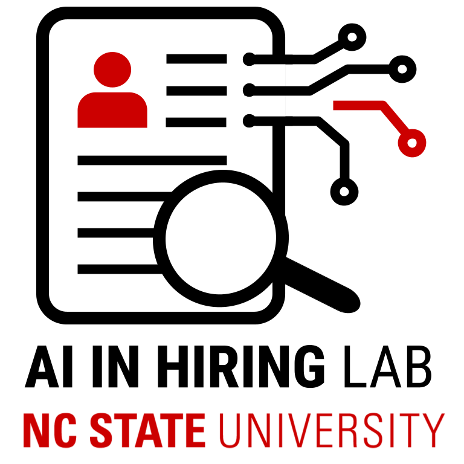

<h2 align="center">AI in Hiring Lab</h2>

  
   
  <em><verysmall>Note: Image created by Britney Schreiber, 9/15/26.</verysmall></em>

The **AI in Hiring Lab** aims to develop new opportunities for better understanding and integrating generative artificial intelligence into recruitment, screening, and hiring technology. 

This initiative is funded by the [North Carolina State University Foundation](https://giving.ncsu.edu/foundation/) and generously supported by NC State University's [Data Science and AI Academy](https://datascienceacademy.ncsu.edu/), [Career Development Center](https://careers.dasa.ncsu.edu/), and [Institute for Advanced Analytics](https://analytics.ncsu.edu/). 

This project involves several initiatives. 

## AI in Hiring Symposium
In order to better understand the various community perspectives into the rapid incorporation of AI into hiring, we organized a local symposium on the topic that brings together national experts and local practitioners in order to share and debate ideas about the promise and pitfalls of AI in hiring. 

[The program](https://stevemcd1.github.io/AIinHiring/program.html) included keynotes from [Hilke Schellmann](https://www.hilkeschellmann.com/) -- Associate Professor, New York University, Emmy Award-winning investigative journalist, and author of [The Algorithm](https://www.hachettebookgroup.com/titles/hilke-schellmann/the-algorithm/9780306827365/) -- and [Ifeoma Ajunwa](https://ifeomaajunwa.com/) -- Asa Griggs Chandler Law Professor and Director of the AI and the Future of Work Program at Emory University, and author of [The Quantified Worker](https://www.cambridge.org/core/books/quantified-worker/CDA274EFF118E3AB6E583424D95DF40D). The afternoon session included panels that revealed the unique perspectives and experiences AI in Hiring among local industry practitioners, academic experts, and college students. 

## Research Projects

### AH - Impact
This series of research projects explores the impact of AI in hiring on job seekers and the labor force. Our survey from NCSU undergraduate students covers a wide range of topics including: 1) general familiarity with and frequent use of AI, 2) use of AI tools as part of job searching, 3) knowledge of and comfort with employers’ use of AI in hiring, 4) perceived benefits and risks of AI use in hiring, and 5) attitudes regarding legal/regulatory approaches to AI in hiring. We are drawing on national survey datasets to examine variation in job search processes and outcomes across educational majors and occupations that are differentially exposed to and trained for AI careers. 

### AH - Interface
We are studying how AI is being integrated into the hiring systems and processes of organizations. This will be accomplished through in-depth interviews with  human resource professionals and hiring managers. We are also examining online discussions among HR professionals about the role of AI in their hiring systems. 

### AH - Frames
This series of studies explores changes over time in the broader discourse about AI in hiring through mixed methods analysis of online news and trade publications. This research tracks variation in the social construction and contestation over AI in hiring by various publics. 

### AH - Efficacy
Here we focus our research lens on the tech itself, engaging in a socio-technical analysis of AI tools to better understand their benefits and blind spots. These investigations include algorithmic audits, affordance analyses, and systems analyses of AI in hiring technology. 

## Outreach and Engagement
Our lab is working with NC State's Career Development Center to enhance the skills of our college students in order to allow them to better navigate the new AI labor market. This will be accomplished by providing a series of student focused workshops with career counseling experts and by developing interactive programming and online exercises for student job seekers. We are also partnering with local business leaders to provide auditing services and guidance for their AI tools. 

## Coordinating Committee
- [Steve McDonald](https://stevemcd1.github.io/), Alumni Association Distinguished Graduate Professor of Sociology
- [Huiling Ding](https://huilingding.wordpress.ncsu.edu/), University Faculty Scholar and Professor of English
- [Kelly Laraway](https://careers.dasa.ncsu.edu/people/kelly-laraway/), Director of Employer Relations, Career Development Center
- [Bill Rand](https://poole.ncsu.edu/people/wmrand/), McLaughlin Distinguished Professor of Marketing and Analytics
- [Munindar Singh](https://csc.ncsu.edu/people/mpsingh/), SAS Institute Distinguished Professor of Computer Science
- Kevin Lee, Legal Scholar, NC State University
- Britney Schreiber, PhD Student in Sociology

## Questions? Interest in Partnering?
Contact [Steve McDonald](https://stevemcd1.github.io/) at [steve_mcdonald@ncsu.edu](mailto:steve_mcdonald@ncsu.edu).  

: Promoting Student Success in the AI Job Market*, funded by the NC State University Foundation, is aimed at helping students understand how AI is used in hiring and how to build skills to improve career readiness.
