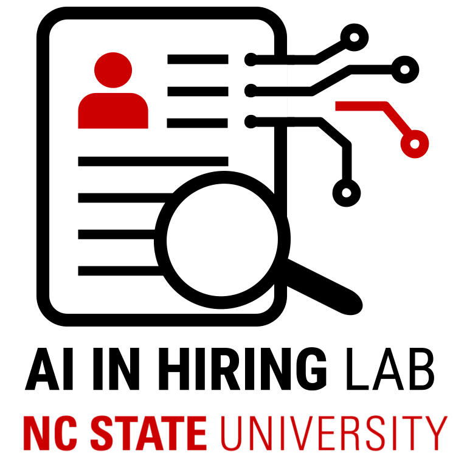

<h2 align="center">Promoting Student Success in the AI Job Market</h2>

  
   
  <em><small>Note: Image created by Britney Schreiber, 9/15/26.</small></em>

*AI in Hiring*

The **AI in Hiring Lab** aims to develop new opportunities for better understanding and integrating generative artificial intelligence into recruitment, screening, and hiring technology. 

This initiative is funded by the [North Carolina State University Foundation](https://giving.ncsu.edu/foundation/) and generously supported by NC State University's [Data Science and AI Academy](https://datascienceacademy.ncsu.edu/), [Career Development Center](https://careers.dasa.ncsu.edu/), and [Institute for Advanced Analytics](https://analytics.ncsu.edu/). 

This project involves several initiatives. 

## Broadening Understanding of AI in Hiring Perspectives

In order to better understand the various community perspectives into the rapid incorporation of AI into hiring, we organized a local symposium on the topic that brings together national experts and local practitioners in order to share and debate ideas about the promise and pitfalls of AI in hiring. The symposium activities are highlighted below:

### Keynote Speakers
#### Hilke Schellmann 
Associate Professor of journalism at New York University. She is a multimedia reporter and documentarian who has made numerous contributions to The Wall Street Journal, The Guardian, The New York Times, VICE, HBO, PBS, TIME, National Geographic, The Atlantic, etc. Her documentary film Outlawed in Pakistan won an Emmy along with several other film awards. In another film, which was a finalist for the Peabody Awards, she investigated the student loan crisis. Her acclaimed book, The Algorithm: How AI Decides Who Gets Hired, Monitored, Promoted, and Fired, And Why We Need To Fight Back. In the book, she investigates the rise of AI in the world of work. Drawing on exclusive information from whistleblowers, internal documents and real‑world tests, she uncovers the many harms associated with the increased use of algorithms for making hiring decisions. 

#### Ifeoma Ajunwa
Asa Griggs Chandler Law Professor and Director of the AI and the Future of Work Program at Emory University. Named among the top 50 legal innovators in academia in 2026, she is an expert in AI Law and Privacy Law. She has testified before the U.S. Congress, advised U.S. governmental agencies like the FTC and the EEOC, and worked with international bodies like the ILO and OECD. An engaged public intellectual, Dr. Ajunwa has contributed op-eds to the NYTimes, Washington Post, The Atlantic, Forbes, Slate, Harvard Business Review, plus legal commentary for National Public Radio (NPR), The Guardian, CNN, Bloomberg, and the Wall Street Journal. She has published widely and extensively, including in top law reviews and other high impact scholarly outlets. Her book, The Quantified Worker, is an impressive work in both scope and depth. It is a touchstone for understanding thorny legal and ethical issues related to AI and work writ large. A major part of the contribution from this trailblazing book addresses the rapid incorporation of AI into hiring systems and the institutional dynamics that are shaping and shaped by this transition. 

#### Industry Panel

#### Academic Panel

#### Student Panel

### Coordinating Committee
- [Steve McDonald](https://stevemcd1.github.io/), Alumni Association Distinguished Graduate Professor of Sociology
- [Huiling Ding](https://huilingding.wordpress.ncsu.edu/), University Faculty Scholar and Professor of English
- [Kelly Laraway](https://careers.dasa.ncsu.edu/people/kelly-laraway/), Director of Employer Relations, Career Development Center
- [Bill Rand](https://poole.ncsu.edu/people/wmrand/), McLaughlin Distinguished Professor of Marketing and Analytics
- [Munindar Singh](https://csc.ncsu.edu/people/mpsingh/), SAS Institute Distinguished Professor of Computer Science
- Kevin Lee, Legal Scholar, NC State University
- Britney Schreiber, PhD Student in Sociology

### Activities to date
During the spring semester, we collected survey data from NCSU undergraduate students. The survey covered a wide range of topics including: 1) general familiarity with and frequent use of AI, 2) use of AI tools as part of job searching, 3) knowledge of and comfort with employers’ use of AI in hiring, 4) perceived benefits and risks of AI use in hiring, and 5) attitudes regarding legal/regulatory approaches to AI in hiring. Preliminary results from the survey were presented at the Ethics and Agentic AI Symposium on May 26 at NC State. Further research is being prepared for publication.  

### Future Activities
- On October 13, 2026, we are bringing national and local experts on AI in hiring to campus for a [public symposium](https://stevemcd1.github.io/AIinHiring/symposium.html) aimed at fostering new and productive conversations about how to best navigate the new challenges associated with the increased use of AI in hiring.
- We will offer a special topics graduate seminar on AI in Hiring in spring 2027. Interested students should contact steve_mcdonald[at]ncsu[dot]edu.  
- We are planning a workshop for students on AI in Hiring during the spring 2027 semester. The workshop will share information about the types of AI tools that have been incorporated into organizational HR practices such as recruitment, screening, and selection of job candidates. Students will also learn about strategies for navigating these tools and ways to engage AI to improve their own job searches.
- Follow up student surveys are being prepared for spring 2027.
- We are developing student learning modules (to be included on the Career Development Center's website) to help students better understand and navigate the new AI hiring landscape. 

: Promoting Student Success in the AI Job Market*, funded by the NC State University Foundation, is aimed at helping students understand how AI is used in hiring and how to build skills to improve career readiness.
